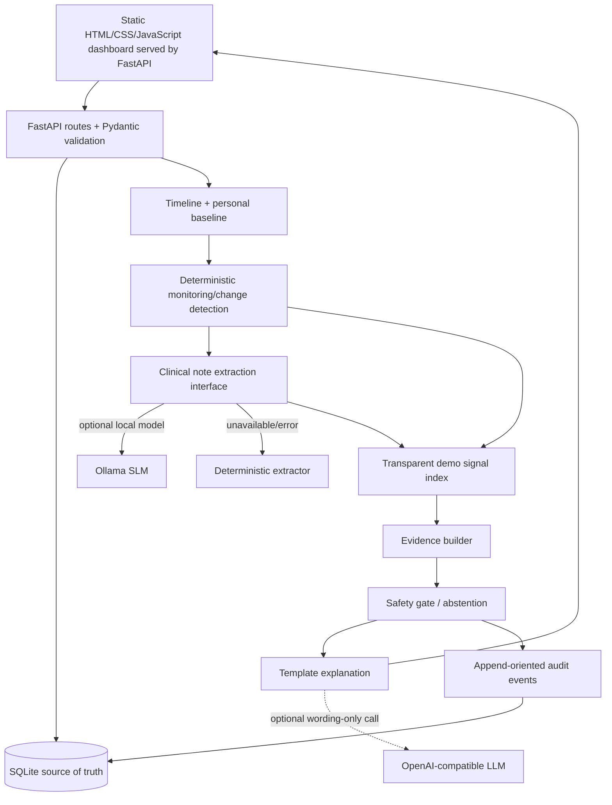

# CARE-AI V1 Architecture

**Version:** 1.0 — cost-first working prototype  
**Purpose:** Implement the first end-to-end slice of the CARE-AI technical blueprint while minimizing recurring inference and infrastructure cost.

> **Safety and intended use.** V1 is a research/college-project prototype for synthetic or de-identified data. It is not clinically validated, does not diagnose or treat, and must not be used to guide real clinical care. The demo signal index is not a calibrated clinical probability.

## 1. Executive decision

CARE-AI remains a longitudinal patient-state and early-warning concept, rather than a single disease classifier. V1 demonstrates ingestion → timeline → personal baseline → change detection → note extraction → demo scoring → evidence → safety gate → human review → audit. The architecture follows the source blueprint's separation of deterministic logic, prediction, evidence and safety, while intentionally deferring production-scale infrastructure.

## 2. V1 scope

### Included

- Synthetic demo patient and editable observation timeline.
- Patient, observation, note, analysis, review and audit persistence.
- Personal baseline using simple robust statistics such as median and median absolute deviation/absolute delta where appropriate.
- Rule-based change detection and transparent demo signal index.
- Local SLM adapter for extracting literal statements from notes, with deterministic fallback.
- Optional, disabled-by-default LLM adapter for wording only.
- Evidence records that refer back to source observations or exact note phrases.
- Deterministic safety gate with `MONITOR`, `REVIEW`, and `ABSTAIN` states.
- Static HTML/CSS/JavaScript dashboard served by FastAPI, FastAPI/OpenAPI, automated tests and local run instructions.

### Deferred

PostgreSQL, object storage, vector database/RAG, LangGraph, asynchronous queues, authentication/SSO, FHIR integrations, OCR, imaging, LSTM/Transformer forecasting, cloud deployment and model registry are not day-one dependencies. Add them only after requirements, labeled data, evaluation and budget justify them.

## 3. Cost-first model routing

| Capability | V1 implementation | Model use |
|---|---|---|
| Input validation, normalization, units, timestamps, deduplication | Pydantic + Python | None |
| Timeline and patient context | SQLite queries | None |
| Baselines and trends | Python statistics | None |
| Significant-change gate | Deterministic rules | None |
| Demo signal index | Documented rule weights | None; not clinical probability |
| Note mentions / negation cues | Optional local Ollama SLM; deterministic fallback | SLM only when configured |
| Evidence linking | Observation/note source references | None |
| Safety/abstention | Deterministic checks | None |
| Explanation text | Template by default | Optional LLM; wording only, off by default |

**Cost rule:** no hosted LLM call is required to start or use the app. Do not ask an LLM to compute a number that Python can calculate. SLM output cannot write database facts or overwrite a score. For remote LLM wording, use only a compact de-identified feature bundle; never transmit a patient name, identifier or raw note.

## 4. Logical architecture

The application is a modular monolith. Logical agent boundaries are modules/functions, not separately deployed services. This keeps cost, local setup and debugging manageable.

## 5. End-to-end flow

1. Validate request shape, allowed observation type, plausible numeric bounds and timestamp.
2. Persist the event and audit metadata. Preserve observation time separately from ingestion time.
3. Build chronological timeline and calculate per-patient baselines from prior observations.
4. Compare the latest value and recent direction with its baseline. Skip unnecessary model calls if there is no note text or a meaningful language task.
5. For a note, call the local SLM only if configured. Constrain response to a JSON schema and verify mentions against the note. On timeout/model failure, use local deterministic extraction and disclose the mode.
6. Compute the demonstration score using documented code rules. Score only known signals; absence of a measurement is not interpreted as normal.
7. Produce evidence items linked to observation IDs and exact note snippets.
8. Apply data-quality and minimum-evidence checks. If checks fail, return `ABSTAIN` and a reason code. Otherwise return a review/monitor state based on demonstration thresholds.
9. Optionally request wording-only refinement from a configured LLM. It does not control scores, evidence IDs, safety state or action. If it fails, use deterministic wording.
10. Persist the assessment and audit trail. A reviewer explicitly records their review outcome.

## 6. Data model

- **Patient:** internal ID, display label, created timestamp, synthetic/de-identified marker.
- **Observation:** ID, patient ID, observation type, numeric value, unit, observed timestamp, ingestion timestamp, source, quality flag, idempotency/source event key.
- **Clinical note:** ID, patient ID, note text (demo/de-identified only), timestamp, extraction mode, structured extracted mentions.
- **Analysis:** ID, patient ID, demonstration signal index (nullable when abstaining), status, reasons, evidence references, SLM/LLM metadata, safety reasons, model/rule version, timestamp.
- **Review:** analysis ID, reviewer label/role, outcome and timestamp.
- **Audit event:** event ID, patient ID, workflow/action, component, status, timestamp and compact detail JSON. Avoid putting raw note text or secrets in logs.

SQLite is the local source of truth. Repository/service interfaces keep database-specific code replaceable. Back up the local DB before deleting or migrating it.

## 7. API surface

| Method | Endpoint | Purpose |
|---|---|---|
| GET | `/api/health` | App/config status; no secret values |
| GET | `/api/patients` | List demo patients |
| POST | `/api/patients` | Create a synthetic/de-identified patient label |
| POST | `/api/demo/seed` | Idempotently seed demo patient and timeline |
| GET | `/api/patients/{id}/timeline` | Chronological observations and notes |
| POST | `/api/patients/{id}/observations` | Add validated observation |
| POST | `/api/patients/{id}/notes` | Add note and run optional extraction |
| POST | `/api/patients/{id}/analyze` | Build demo assessment, evidence and safety decision |
| GET | `/api/patients/{id}/analyses` | Retrieve assessment history |
| POST | `/api/analyses/{id}/review` | Save human review outcome |
| GET | `/api/patients/{id}/audit` | Retrieve event history |

## 8. Safety and limits

- All default data is synthetic.
- An extracted phrase must be grounded in source text; if it cannot be verified, it is discarded.
- A model timeout is not a result. Use fallback where possible and record that fallback; otherwise abstain.
- Score/status are deterministic and independent of LLM narration.
- V1 thresholds are chosen only to exercise software flows, not copied from clinical guidelines.
- There is no trained or clinically calibrated forecasting model in V1 because a validated target and labeled dataset are not supplied.
- No real clinical use until formal data governance, security, clinical validation and prospective evaluation are completed.

## 9. Acceptance criteria

1. App boots without an API key or model download.
2. OpenAPI page loads and health responds.
3. Demo seeding is repeatable without duplicating records.
4. Ingestion -> timeline -> analysis -> evidence -> safety -> review -> audit works.
5. Insufficient evidence returns `ABSTAIN`, not a fabricated score.
6. Local SLM-offline path falls back cleanly.
7. Optional LLM remains disabled unless explicitly configured and cannot alter structured outcome fields.
8. Backend tests pass and static dashboard loads from the FastAPI root route.

## 10. Roadmap after V1

**V1.1:** stronger RBAC/auth, PostgreSQL migration, audit retention, configuration validation.  
**V1.2:** choose one clearly defined outcome and approved public/de-identified dataset; train/evaluate Logistic Regression or XGBoost against baselines.  
**V1.3:** use a clinical NLP model only if extraction tests show the deterministic/SLM baseline is insufficient; compare structured extraction quality and latency.  
**V2:** temporal models, retrieval of approved evidence, background jobs and production operations only when supported by dataset size, validation and budget.
